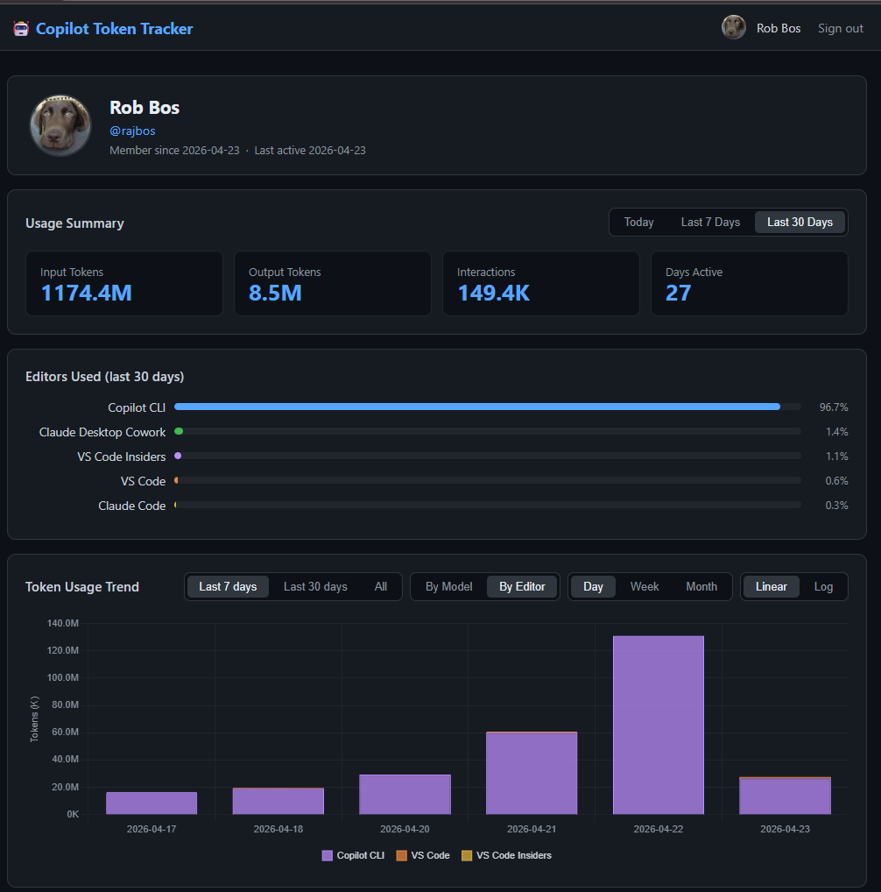

# Self-Hosted Sharing Server

> **Opt-in & self-hosted** — This feature is entirely optional. Nothing is shared unless
> you deploy your own server and explicitly enable the setting in VS Code. No data is
> sent to any third-party service.

The sharing server lets you aggregate Copilot token usage across a team on infrastructure
you own. It is a lightweight Node.js API backed by SQLite — run it with Docker on any
machine, point your team's VS Code extensions at it, and get a shared dashboard without
needing an Azure account.

For server coding, testing or customization, follow the
[authoritative data separation contract](../../sharing-server/AGENTS.md).

## What it does

```
┌──────────────────┐         ┌──────────────────┐         ┌────────────────┐
│  VS Code / CLI   │──POST──▶│  Sharing Server   │──read──▶│  Web Dashboard │
│  (auto-uploads)  │ Bearer  │  (your infra)     │ SQLite  │  (GitHub login)│
└──────────────────┘ token   └──────────────────┘         └────────────────┘
```

1. **Upload** — The VS Code extension already holds a GitHub OAuth token (the same one
   used by Copilot). When you enable the sharing server setting, the extension
   automatically uploads daily usage rollups to your server. No new login, no API keys.
2. **Store** — The server validates the GitHub token, identifies the user, and upserts
   the rollup into a local SQLite database.
3. **View** — Team members sign in to the web dashboard with GitHub OAuth and see their
   own usage — input/output tokens, interactions, days active, editor breakdown, and
   usage trends over time.
4. **Compare** — Open **Team Insights** at `/team` to compare your usage with anonymous
   active uploaders without exposing their identities or uploaded detail.

## Dashboard preview



The web dashboard shows per-user usage summaries with time-range filters (Today /
Last 7 Days / Last 30 Days), an editor breakdown chart, and a token usage trend graph
grouped by editor or model.

## Team Insights

The cookie-authenticated `/team` page offers 7-, 30- and 90-day windows, each
covering exactly N UTC dates including today and excluding future dates.
It shows exact anonymous active-member token/interaction totals, activity-day
counts and a self marker, together with your rank, share of team tokens,
percentile and **Light / Medium / Heavy / Very heavy** relative usage cohort.
Only positive tokens or interactions make a member active; inactive viewers
have no comparison. Trends show the team aggregate and your own usage, never
individual peers' daily series.

Period links (`/team?days=N`) work without JavaScript. The page includes cohort
counts/thresholds and an exact numeric member table, plus expandable daily
team/own totals. The aggregate chart can show team totals or the average per
daily active uploader alongside your own line. CSV and JSON downloads at
`/team/export?days=N&format=csv|json` (choose one format) require the same session
cookie and reuse the safe projection; they cannot reveal additional peer detail.

Cohorts use interpolated p25/p50/p75 of active members' total input + output tokens
with `<=` boundaries. Ties share rank/cohort; percentile is the percentage of
other active uploaders strictly below you, and is undefined without peers.
See the [comparison definitions](../../sharing-server/AGENTS.md#period-and-comparison-semantics)
and [API reference](../../sharing-server/README.md#team-insights) for
`GET /api/team-insights?days=7|30|90` (choose one value; bearer authentication).

**Anonymous labels are not guaranteed anonymity.** Direct identifiers are removed,
but exact totals and small-team comparisons can still re-identify members.
There is no minimum count or suppression. Named admin detail remains on separate
server-authorized admin routes, and personal uploaded rows remain owner-only.
Even admins viewing Team Insights receive the same identity-free projection.

---

## Setup guide

### Prerequisites

- Docker (or Node.js ≥ 22.5 if running without Docker)
- A [GitHub OAuth App](https://github.com/settings/developers) — needed for the web
  dashboard login

### 1. Create a GitHub OAuth App

1. Go to **GitHub → Settings → Developer settings → OAuth Apps → New OAuth App**
2. Fill in:
   - **Application name**: `AI Engineering Fluency` (or any name you like)
   - **Homepage URL**: `https://your-server.example.com`
   - **Authorization callback URL**: `https://your-server.example.com/auth/github/callback`
3. Copy the **Client ID** and generate a **Client Secret**

### 2. Deploy with Docker Compose

Create a `docker-compose.yml`:

```yaml
services:
  sharing-server:
    image: ghcr.io/rajbos/copilot-sharing-server:latest
    ports:
      - "3000:3000"
    environment:
      - GITHUB_CLIENT_ID=your_client_id
      - GITHUB_CLIENT_SECRET=your_client_secret
      - SESSION_SECRET=a_long_random_string_min_32_chars
      - BASE_URL=https://your-server.example.com
      # Optional: restrict to members of a specific GitHub org
      # - ALLOWED_GITHUB_ORG=your-org-name
    volumes:
      - sharing_data:/data
    restart: unless-stopped

volumes:
  sharing_data:
```

> **Tip**: Generate `SESSION_SECRET` with `openssl rand -hex 32`.

Start the server:

```bash
docker compose up -d
```

Verify it's running:

```bash
curl https://your-server.example.com/health
# → {"status":"ok","timestamp":"..."}
```

### 3. Configure the VS Code extension

Add these settings in VS Code (JSON):

```json
{
  "aiEngineeringFluency.backend.sharingServer.enabled": true,
  "aiEngineeringFluency.backend.sharingServer.endpointUrl": "https://your-server.example.com"
}
```

Or search for **AI Engineering Fluency: Sharing Server** in the Settings UI.

That's it. The extension starts uploading daily rollups automatically — no extra
authentication prompt, no API keys. It reuses your existing GitHub session from VS Code.

---

## Environment variables

| Variable | Required | Default | Description |
|---|---|---|---|
| `GITHUB_CLIENT_ID` | ✅ | — | GitHub OAuth App client ID |
| `GITHUB_CLIENT_SECRET` | ✅ | — | GitHub OAuth App client secret |
| `SESSION_SECRET` | ✅ | — | Random secret for signing session cookies (≥ 32 chars). **Required when `NODE_ENV=production`** (the Docker image default): startup fails if it is missing, too short, or the dev default, because admin sessions would be forgeable. Outside production an insecure dev fallback is used with a warning |
| `BASE_URL` | ✅ | — | Public URL of the server (no trailing slash) |
| `PORT` | ❌ | `3000` | HTTP listen port |
| `DB_PATH` | ❌ | `/data/sharing.db` | SQLite database file path |
| `ALLOWED_GITHUB_ORG` | ❌ | *(any user)* | Restrict uploads and dashboard to members of this GitHub org |

---

## How authentication works

The sharing server does **not** issue its own API keys.

- **Data uploads** (from the VS Code extension) use a **Bearer token** — the same
  GitHub OAuth token already held by VS Code. The server validates it by calling
  `GET https://api.github.com/user` and caches the result for 10 minutes.
- **Web dashboard** login uses a standard **GitHub OAuth flow** (the OAuth App you
  created in step 1). Users sign in via the browser and receive a signed session cookie.

If `ALLOWED_GITHUB_ORG` is set, both uploads and dashboard access are restricted to
members of that GitHub organization.

---

## Privacy & data

- **Opt-in only** — No data is uploaded unless you explicitly enable the setting and
  provide a server URL.
- **Self-hosted** — The server runs on your infrastructure. Data never leaves your
  network (unless you expose the server publicly).
- **Identified storage** — Every upload is linked to a GitHub user ID; uploads are
  not anonymous or pseudonymous (unlike the Azure Storage backend). Team Insights
  removes direct peer identifiers at the server response boundary; see the
  [data separation contract](../../sharing-server/AGENTS.md#team-projection)
  for the allowlist and residual re-identification risk.
- **Workspace/machine names** — Included or excluded based on the extension's
  `shareWorkspaceMachineNames` setting (off by default).
- **Rollups only** — The extension sends daily aggregates (tokens, interactions, model
  names), not raw prompts or completions.
- **Editor attribution** — Each rollup includes the session's editor label. This preserves
  session-specific sources such as `Copilot CLI (App)` separately from terminal
  `Copilot CLI` usage in the personal dashboard. Peer model/editor labels are
  not included in Team Insights.

---

## Backup

The entire server state lives in a single SQLite file (`/data/sharing.db` by default).
Back it up with any file copy tool or:

```bash
sqlite3 /data/sharing.db .dump > backup.sql
```

---

## Running without Docker

See the [sharing server README](../../sharing-server/README.md) for instructions on
building from source and running locally with Node.js.

For changes, use the [server validation guidance](../VALIDATION.md#sharing-server)
and the [required privacy regression tests](../../sharing-server/AGENTS.md#required-validation).
Downstream route overrides and exports must preserve the same contract.
